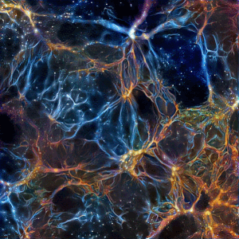

*******************
Quijote simulations
*******************

The Quijote simulations is a suite of more than 82,000 full N-body simulations designed to:

- Quantify the information content on cosmological observables
- Provide enough statistics to train machine learning algorithms

This video shows how changes in the cosmological parameters values affects the cosmic web:

.. raw:: html

   <iframe width="560" height="315" src="https://www.youtube.com/embed/fg-xajtVeLg" title="YouTube video player" frameborder="0" allow="accelerometer; autoplay; clipboard-write; encrypted-media; gyroscope; picture-in-picture; web-share" allowfullscreen></iframe>

We have run three simulations: 1) with the fiducial Quijote cosmology (shown on the left), 2) with a low value of :math:`\Omega_{\rm m}` equal to 0.2 (shown on the right), and 3) with a high value of the Hubble constant :math:`h` equal to 0.9 (shown on the top after 1 minutes and 15 seconds). The initial phases of the simulations are all the same, and changes are driven by the differences in the value of the cosmological parameters. The simulation with high :math:`h` has been flipped along the x axis to mimick the effect of a mirror along the middle of the screen. The video illustrates how changes in the value of the cosmological parameters induce differences in the positions, masses, and internal properties of dark matter halos. Quijote has been designed to quantify how well can we infer the value of the cosmological parameters given the statistical properties of the cosmic web.
  
Historically, Quijote was developed from the `HADES simulations <https://franciscovillaescusa.github.io/hades.html>`_. Nowadays, it contains the full HADES data.

  
Quijote Literature Atlas
========================

Hundreds of papers have been written using the Quijote simulations, covering topics from field-level machine learning and simulation-based inference to higher-order statistics, primordial non-Gaussianity, and massive neutrinos. To help navigate this body of work, we have built the **Quijote Literature Atlas**: an interactive map of all papers that use Quijote. With it you can explore how the papers relate to each other by topic, follow the citation and co-author networks, and identify connections between research lines as well as gaps that are still open.

.. raw:: html

   

     <iframe src="https://franciscovillaescusa.github.io/literature-atlas/quijote/#topics"
             title="Quijote Literature Atlas"
             loading="lazy"
             style="width: 100%; height: 800px; border: 1px solid #e1e4e5; border-radius: 6px;"
             allowfullscreen></iframe>
     

       <a href="https://franciscovillaescusa.github.io/literature-atlas/quijote/#topics"
          target="_blank" rel="noopener"
          style="display: inline-block; padding: 0.5em 1.2em; background: #2980b9; color: #fff; border-radius: 4px; text-decoration: none; font-weight: bold;">
         Open the atlas in full screen &#8599;
       </a>
     

   

.. toctree::
   :maxdepth: 2
   :caption: Quijote

   news
   goals
   features
   access
   organization
   tutorials
   publications
   atlas
   team
   citation
   

.. toctree::
   :maxdepth: 2
   :caption: Simulations

   types
   lcdm
   w
   Mnu
   su
   png
   odd
   mg
   LH
   bsq
   Hades
   ulagam
   collider

.. toctree::
   :maxdepth: 2
   :caption: Data products
   
   snapshots
   halos
   galaxies
   sancho
   gigantes
   voids
   Pk
   bispectra
   xi
   pdf
   df
   halo_statistics
   interlopers
   3PCF

.. toctree::
   :maxdepth: 2
   :caption: Other

   logo
   license
   faq
   help
